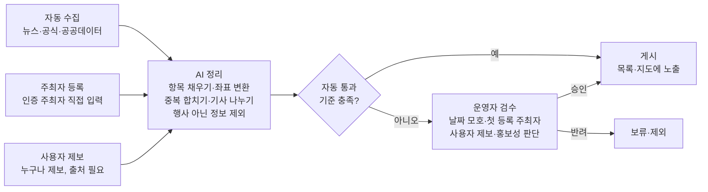

# 주류 행사·콘텐츠 통합 플랫폼 기획서 v0.1

작성일: 2026-11-07

## 1. 개요

흩어져 있는 국내 주류 행사 정보를 한곳에 모아, 누구나 "이번 주말 어디서 무슨 술 행사가 열리는지" 바로 찾을 수 있게 하는 서비스다. 1차 목표는 대형 박람회부터 동네 바틀샵 시음회까지 국내 주류 행사를 규모 구분 없이 모으는 것이다.

**배경.** 주류 행사 정보는 공식 홈페이지, 뉴스, 인스타그램, 블로그, 카페에 흩어져 있다. 한 커뮤니티에서는 이용자가 박람회 홈페이지를 하나하나 찾아 정리한 2026 주류박람회 일정 글이 조회수 1만 9천 회를 넘겼다. 수요는 분명한데 한데 모아주는 서비스는 아직 없다는 신호다.

**핵심 가치.**

- 한곳에서 본다: 규모·주종·지역 구분 없이 모든 주류 행사를 한 화면에서 탐색
- 믿을 수 있다: 자동 수집 + 운영자 검수로 날짜·장소가 확인된 정보만 게시
- 작은 행사까지 보인다: 주최자 직접 등록으로 다른 곳에 없는 소형 행사 확보

**대상 사용자.** 주말 나들이로 주류 행사를 찾는 일반 애호가(성인), 특정 주종을 깊게 즐기는 마니아, 행사를 알리고 싶은 바틀샵·바·양조장·수입사 등 주최자.

## 2. 서비스 범위

1차는 국내 주류 행사 캘린더에만 집중하고, 콘텐츠 모아보기와 해외 행사는 이후 단계로 미룬다. 두 기능을 동시에 만들면 둘 다 어중간해질 위험이 있어서, 행사 캘린더로 먼저 사용자를 모은 뒤 확장한다.

| 단계 | 범위 | 주요 기능 |
| --- | --- | --- |
| 1차 (MVP) | 국내 주류 행사 | 행사 목록·상세, 날짜·지역·주종·규모 필터, 지구본→지도 탐색, 주최자 등록, 사용자 제보 |
| 2차 | 주류 콘텐츠 모아보기 | 큐레이션 사이트·리포트·기사·커뮤니티 글을 제목·요약·원문 링크로 모아보기 |
| 3차 | 해외 행사 | 일본 등 인접국부터 해외 주류 행사로 확장, 지구본 지도의 쓰임이 커지는 단계 |

1차에서는 술 판매나 예매 결제를 하지 않는다. 예매·구매는 주최 측 페이지로 연결만 한다.

## 3. 수집 범위와 실현 가능성

국내 주류 행사 100%를 자동 수집하는 것은 불가능하다. 대형은 거의 전부, 중형은 상당 부분, 소형은 일부만 자동으로 잡히고, 나머지는 주최자 등록과 제보로 채운다.

| 규모 | 예시 | 정보가 올라오는 곳 | 자동 수집 가능성 (추정) |
| --- | --- | --- | --- |
| 대형 | 박람회, 지역 주류 축제 | 공식 홈페이지, 전시장 일정, 뉴스, 공공데이터 | 90% 이상 |
| 중형 | 유통사·카드사 와인 페스타, 브랜드 체험 행사 | 보도자료, 뉴스, 기업 SNS | 60\~70% |
| 소형 | 바틀샵 시음회, 바 게스트 바텐딩, 클래스 | 인스타그램, 블로그·카페, 카카오 채널 | 10\~30% |

수치는 경험 기반 추정치이며, 샘플 수집 단계에서 실측해 갱신한다. 소형 행사가 약한 주된 이유는 인스타그램 등 로그인 기반 서비스가 약관으로 자동 수집을 막기 때문이다.

**실제 데이터로 확인한 사례 (2026년).**

- 대형: [서울국제주류&와인박람회](https://www.hankyung.com/article/202606108224O) 6/18\~20 코엑스 C홀, 35회째, 360여 개 기업 참가 · [부산국제주류박람회](https://news.knn.co.kr/news/article/191295) 8월 벡스코
- 지역 축제: [영동 대한민국와인축제, 군산 수제맥주&블루스 페스티벌, 춘천 술 페스타](https://www.sisa-news.com/news/article.html?no=270425) 등은 기사 한 건에 여러 행사가 함께 실림
- 중형: [브랜드 거리 행진·막걸리 축제 참여 등 업계 체험 마케팅](https://www.segye.com/newsView/20261014521861)이 늘어나는 추세

## 4. 정보 수집 구조

세 개의 입구로 들어온 정보를 AI가 정리하고, 기준을 충족하는 정보는 자동 게시하며 나머지만 운영자가 확인한다. 신문사 편집국에 비유하면 기자·외부 기고·독자 제보를 편집 보조가 정리하고 편집장이 애매한 원고만 판단하는 구조다.

자동 통과 기준은 "언론·공식 출처 또는 인증 주최자 + 날짜·장소 명확"이다. 2026년 실제 기사와 가상 소형 행사로 시연한 결과 11건 중 7건이 자동 통과했고 4건만 운영자 확인이 필요했다. 기사 한 건에 행사 여러 개가 실리는 경우(1건 → 4건)와 신제품 출시처럼 행사가 아닌 기사가 많아, AI의 나누기·거르기 정확도가 핵심이다.

## 5. 운영 기준 (B안: 인증 주최자형)

공식·언론 출처로 확인된 행사와 사업자 확인을 마친 주최자의 직접 등록만 게시하고, 사용자 제보는 운영자 확인 후 게시한다. 법적 부담을 낮게 유지하면서 소형 행사를 확보하는 안이다. 유료 상단 노출은 외부에 판매하지 않고, 관리자 화면에서만 노출 후보를 표시·관리하는 내부 기능으로 둔다.

**B안 세부 규칙.**

| 항목 | 기준 |
| --- | --- |
| 게시 대상 | 실제로 방문·참여할 수 있는 주류 행사 (박람회, 축제, 시음회, 클래스, 브랜드 체험 행사) |
| 제외 대상 | 신제품 출시 소식, 단순 할인·판촉, 경품 이벤트, 날짜나 장소가 없는 정보 |
| 자동 통과 | 언론·공식 출처 또는 인증 주최자 + 날짜·장소가 모두 명확 |
| 운영자 검수 | 날짜 모호, 처음 등록한 주최자, 사용자 제보, 브랜드 홍보성 판단이 필요한 건 |
| 주최자 인증 | 첫 등록 시 사업자 정보·연락처 확인, 이후 자동 통과 |
| 사용자 제보 | 바로 게시하지 않고 운영자가 출처 확인 후 게시 |
| 유료 노출 | 1차에서는 운영하지 않음. 관리자 전용 노출 후보 관리 기능으로 대체 (일반 사용자 화면 영향 없음) |

**공통 법적 기본선 (모든 단계에 적용).**

1. 사실 정보(행사명·날짜·장소·주종)만 저장하고 원문은 링크로 연결한다. 소개글·사진은 복사하지 않으며, 주최자가 등록한 사진은 사용 동의를 받는다.
2. 국민건강증진법상 주류광고 기준을 반영한 표현 가이드를 적용한다. 음주 권장, 건강 효능, 경품·금품 표현을 쓰지 않으며 주최자 글도 이 기준으로 검수한다. 2026년 11월 9일부터 주류광고 경고문구·경고그림 표시가 강화되는 점도 반영한다.
3. 술 판매와 결제는 하지 않는다. 온라인 주류 판매는 전통주 등 예외만 허용되므로 예매는 주최 측으로 안내한다.
4. 자동 수집 시 각 사이트의 수집 허용 규칙과 이용약관을 지키고, 방문 빈도를 제한하며, 원 출처의 삭제 요청은 즉시 처리한다.
5. 제보자 개인정보는 최소한만 수집한다.
6. 최소한의 성인 확인 절차를 두고, 수준은 법률 검토로 정한다.

참고: [주류광고 기준과 위반 사례](https://economist.co.kr/article/view/ecn202206250008), [경고문구 강화 시행일 정리](https://braindetox.kr/posts/alcohol_warning_label_nov_9_2026.html). 최종 확정 전 변호사 검토가 필요하다.

## 6. 지도 기능 (②안: 지구본 → 일반 지도 전환형)

멀리서는 지구본으로 보이고, 확대하면 거리까지 보이는 일반 지도로 자연스럽게 바뀌는 방식으로 만든다. 지구본은 메인 도구가 아니라 첫 화면 연출과 탐색용 보조 도구로 쓰고, 주 탐색은 날짜순 목록이 맡는다.

| 방식 | 장점 | 단점 | 결정 |
| --- | --- | --- | --- |
| ① 가벼운 지구본 | 빠르고 무료 | 확대하면 거리·건물이 안 보임 | 미채택 (시연용) |
| ② 지구본 → 일반 지도 전환 | 구글 어스 느낌 + 실제로 쓸 만한 지도 | 무료 구성으로만 운영 (MapLibre + 무료 지도 데이터) | 채택 |
| ③ 구글어스급 실사 3D | 건물까지 입체로 보이는 최고 비주얼 | 비용 큼, 휴대폰에서 무겁고 배터리 소모 큼 | 미채택 |

**지도 서비스 결정.** 무료 서비스로만 구성한다. 지도를 그리는 도구는 무료 오픈소스인 MapLibre를 쓰고, 지도 데이터는 OpenFreeMap 같은 무료 공개 지도와 국토교통부 브이월드 오픈API(한국 상세, 키 발급 필요)를 후보로 비교한다. 무료 서비스는 호출량 제한과 이용 조건이 있어 1단계에서 확인한다.

**UX 원칙.**

- 첫 화면: 지구본이 돌다가 한국으로 내려오는 연출로 서비스 정체성을 전달
- 주 탐색: 날짜순 목록과 지도를 나란히 배치, "이번 주말·내 근처" 질문에 바로 답함
- 겹친 행사: 숫자 묶음으로 표시하고 누르면 해당 지역으로 확대
- 길찾기: 국내 사용자에게 익숙한 카카오맵·네이버지도로 연결
- 접근성: 지도에 있는 모든 정보는 목록으로도 볼 수 있게 함

**데이터 영향.** 행사 데이터에 위도·경도 항목을 추가하고, 수집 과정에서 주소를 좌표로 자동 변환한다.

참고로 해외 지도 서비스의 한국 상세 정보는 [고정밀 지도 반출 관련 정책 변화](https://biz.heraldcorp.com/article/10877454)로 바뀌는 중이라, 길찾기는 국내 지도 서비스로 넘기는 것이 안정적이다.

## 7. 의사결정 기록

지금까지 PM 승인으로 확정된 사항은 일곱 가지다.

| 순서 | 결정 사항 | 내용 |
| --- | --- | --- |
| 7 | 운영자 검수 인력 | 1명 (처리 기준은 8장 제안, 승인 대기) |
| 6 | 지도 서비스 | 무료 서비스로만 구성 |
| 5 | 유료 상단 노출 | 외부 판매 대신 관리자 전용 노출 후보 관리 기능 |
| 4 | 지도 방식 | ②안 지구본→일반 지도 전환형, 첫 화면 연출 + 목록과 함께 쓰는 보조 도구 |
| 3 | 운영 기준 | B안 인증 주최자형, 사용자 제보는 운영자 확인 후 게시 |
| 2 | 수집 방식 | 자동 수집 + 주최자 등록 + 사용자 제보 + 운영자 검수의 하이브리드 |
| 1 | 작업 순서 | 운영 기준을 데이터 항목 정리보다 먼저 확정 |

## 8. 미결 사항과 리스크

가장 큰 리스크는 소형 행사 확보가 주최자 참여에 달려 있다는 점이다. 주최자가 등록할 이유(노출 효과)를 초기에 만들어야 한다.

**미결 사항 (추후 결정).**

- [ ] 성인 확인 절차 수준 (법률 검토 후 결정)
- [ ] 브랜드 홍보성 이벤트 중 어디까지를 "참여 가능한 행사"로 볼지 세부 예시 확정
- [ ] 무료 지도 데이터 최종 선택과 이용 조건 확인 (무료로만 운영하는 것은 결정됨)
- [ ] 운영자 검수 처리 기준 승인 (인력 1명은 결정됨, 기준은 아래 제안)

**운영자 검수 처리 기준 (제안, 승인 대기).** 검수자가 1명이라 고정 건수보다 처리 기한을 기준으로 삼는다.

| 항목 | 제안 |
| --- | --- |
| 처리 기한 | 접수 후 1영업일 안에 처리 |
| 긴급 건 | 행사일이 3일 이내면 당일 처리 |
| 하루 처리량 | 20\~30건 기준 (1건당 3\~5분, 하루 약 1.5\~2.5시간) |
| 처리 순서 | 행사일 임박 순 → 첫 등록 주최자 → 사용자 제보 |
| 대기 누적 시 | 대기 50건 이상이면 자동 통과 기준을 다시 점검 |
| 검수자 부재 시 | 자동 통과 건은 그대로 게시, 검수 대기 건은 복귀 후 처리 |

하루 처리량은 하루 후보 60\~80건 중 시연 결과처럼 약 3분의 1이 검수로 넘어온다고 가정한 추정치다. 2단계 샘플 수집 후 실측해 조정한다.

**리스크.**

| 리스크 | 영향 | 대응 |
| --- | --- | --- |
| 소형 행사 주최자 참여 저조 | 차별점 약화 | 초기 주최자 직접 섭외, 등록 절차 간소화 |
| 주최자 글의 음주 권장 표현 | 주류광고 기준 위반 소지 | 표현 가이드 + 등록 시 자동 점검 + 검수 |
| 출처 사이트의 수집 차단·약관 변경 | 대형·중형 수집량 감소 | 출처 다변화, 공공데이터 우선 활용 |
| 잘못된 날짜·취소된 행사 게시 | 신뢰도 하락 | 행사 직전 재확인, 사용자 신고 기능 |

## 9. 다음 단계 로드맵

다음 작업은 1단계 데이터 항목 정의다. 각 단계는 결과물을 PM이 확인·승인한 뒤 다음으로 넘어간다.

1. **데이터 항목 정의**: 행사 하나에 담을 정보(행사명, 기간, 장소, 위도·경도, 주종, 규모, 유·무료, 예약 필요 여부, 연령 제한, 출처 링크 등)와 수집 대상 출처 목록 확정
2. **샘플 수집**: 실제 행사 20\~30건을 모아 품질과 자동 수집 비율을 실측
3. **자동 수집기 개발**: 출처 1개부터 시작해 점차 확대, 주소→좌표 자동 변환 포함
4. **주최자 등록·제보·검수 화면**: B안 운영 기준을 반영한 입력 폼과 운영자 검수 화면
5. **사용자 화면 시제품**: 날짜순 목록 + 지구본→지도 전환형 탐색
6. **UX 디자인**: 사용성 우선 설계 후 비주얼 시안 3\~4개 제안, 디자인 요소는 컴포넌트 토큰으로 관리
7. **오픈 준비**: 성인 확인·표현 가이드 등 법률 검토 반영 후 MVP 오픈
